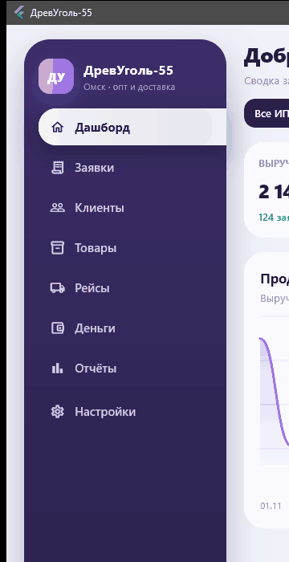
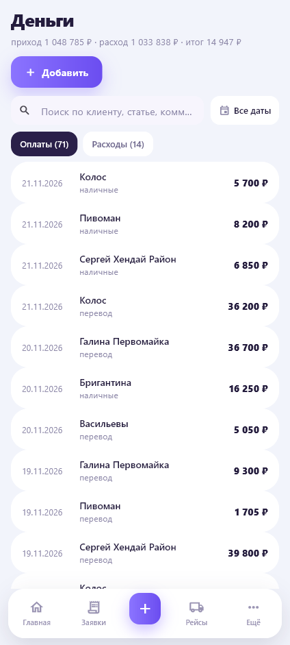
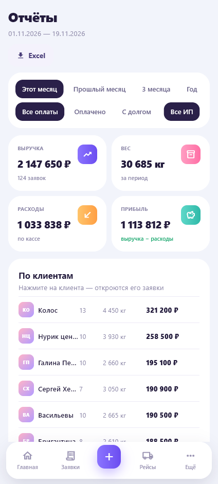

# ДревУголь-55 — приложение

Внутреннее приложение для оптовой продажи и доставки древесного угля (Омск).
Работает офлайн, данные хранятся локально, синхронизация — через Яндекс Диск.

## Скачать и установить

Версия 0.5.1 → **[Releases](https://github.com/GXWag/drevugol-55/releases/tag/v0.5.1)**

**Windows 11**
1. Скачать `drevugol55-setup-0.5.1.exe` и запустить — установится в «Пуск» и на рабочий стол.
2. Либо `drevugol55-windows-0.5.1.zip` — портативная версия: распаковать и запустить.

**Android**
1. Скачать `drevugol55-0.5.1.apk` на телефон.
2. Разрешить установку из этого источника и установить.

Проверка версии: **Настройки** → внизу «версия 0.5».

## Синхронизация

Настройки → Синхронизация:
- вставить OAuth-токен Яндекс Диска;
- придумать пароль шифрования (одинаковый на всех устройствах);
- выбрать номер устройства (1–4, на каждом свой).

Данные шифруются и хранятся в папке `Приложения/ДревУголь-55` на Диске.

## Что нового в 0.5.1

- Синхронизация через Яндекс Диск: файл шифруется паролем, устройства обмениваются изменениями.
- Чистый старт: демо-данные больше не создаются.
- Установщик Windows.
- Проверка обновлений в настройках.
- Кнопка «Очистить все данные».

### Если не запускается

**Windows: «Не удается найти VCRUNTIME140_1.dll»** — используйте установщик 0.5.1: библиотеки Visual C++ уже внутри.

**Android: висит заставка Flutter** — обновите APK (переустановите поверх). Если снова заставка, теперь приложение покажет экран с текстом ошибки — пришлите его фото.

## Рабочая версия (Windows)

Уже собрано и работает: заявки с индивидуальными ценами, клиенты и прайсы, товары,
рейсы, деньги и расходы, отчёты с выгрузкой в Excel, документы (счёт, УПД, ТОРГ-12, ТТН).

### Дашборд

### Заявки

### Новая заявка

### Клиенты

### Отчёты

### Анимация меню

## Макет (для сравнения)

### Дашборд

### Новая заявка

## Телефон

| Главная | Заявки |
|---|---|
|  |  |

| Новая заявка | Деньги |
|---|---|
|  |  |

| Отчёты | Клиенты |
|---|---|
|  |  |

## Что нового в 0.4.0

- В заявке выбирается документ: **Накладная** (по умолчанию, номер б/н), **УПД**, **ТОРГ-12**, **ТТН**. Номер подставляется свой для каждого клиента и документа, его можно изменить.
- В заявках появились столбец «Комментарий» и кнопки **Отгружено** и **Оплата** прямо в списке.
- Фильтры в виде выпадающих списков: статус, оплата, ИП (на компьютере и на телефоне).
- Способы оплаты: наличные, перевод, счёт.
- У клиента можно включить «Несколько ИП / ООО» и вести список организаций; в заявке выбирается организация, в списке она показывается перед датой.
- Убрана лишняя кнопка «Оплата» в шапке заявки.
- Ползунок прокрутки отодвинут от кнопок и текста.
- **Тёмная тема**: Настройки → Внешний вид (светлая / тёмная / как в системе).

## Что нового в 0.3.0

- Товары на телефоне — карточками, текст больше не ломается по буквам.
- Главная на телефоне: убран график, выбор месяца перенесён вправо вверх (вместо кнопки создания заявки), плитки выровнены и растянуты по ширине.
- Заявки на телефоне: отступы между карточками, кнопка «Новая заявка» убрана (создание — «плюс» внизу).
- В меню «Ещё» добавлены «Клиенты» — карточки и прайс редактируются.

## Что нового в 0.2.0

- Исправлена мобильная вёрстка (текст больше не идёт по букве в столбик), добавлены отступы по краям.
- В заявке сначала количество, потом цена.
- Два статуса: «В работе» и «Отгружено».
- Заявки: фильтры по оплате, ИП, дате (день или период), сортировка, выбор нескольких заявок с итогами.
- Дашборд: плитки с выбором периода, «Чистая прибыль» вместо среднего чека, график реагирует на ИП и период.
- Отчёты: фильтры по датам и оплате, переход в карточку клиента и в продажи по товару.
- Деньги: редактирование и удаление операций, полный список, поиск и фильтр по датам.
- Убран лишний «плюс» справа снизу; создание заявки — по «плюсу» в нижнем меню.

## Что учтено

- три ИП с разными налогами: Масличенко (наличка, без НДС), Яснова (НДС 22 %), Худорожков (УСН 6 %, без НДС);
- цена привязана к клиенту, а не к товару; подставляется автоматически;
- быстрый ввод: выбрал клиента — вводишь только количества;
- вес считается по углю и брикетам, жидкость не входит;
- статусы, частичная оплата, долги;
- документы: счёт, УПД, ТОРГ‑12, ТТН, накладная.

## Файлы

- `shots/` — скриншоты приложения и макета;
- `desktop-*.html`, `mobile-*.html` — макет, открывается в браузере;
- `style.css` — оформление макета.
