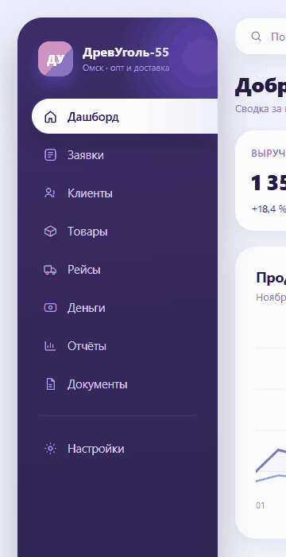
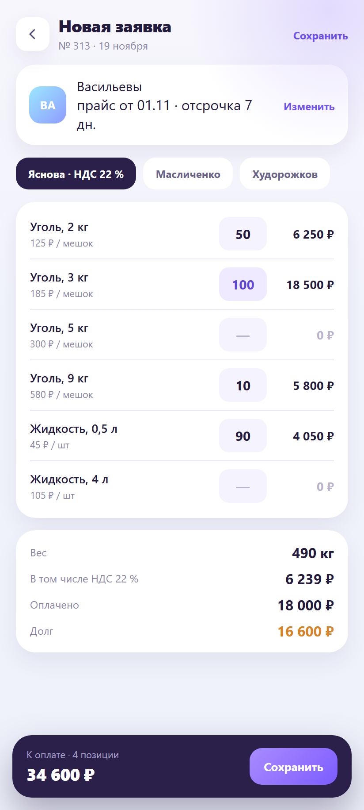

# ДревУголь-55 — макет приложения

Внутреннее приложение для оптовой продажи и доставки древесного угля (Омск).
Макет интерфейса: как будет выглядеть программа на компьютере и на телефоне.

> Это **макет для согласования**, а не рабочая программа. Финальная версия — нативное приложение: Android (APK) + Windows 11 (.exe), работа офлайн, синхронизация через Яндекс Диск.

## Компьютер

### Дашборд

### Новая заявка

### Анимация выбора в меню
Активный пункт выезжает белой пилюлей и сливается с фоном, как в референсе.

## Телефон

| Главная | Новая заявка |
|---|---|
|  |  |

## Что уже учтено

- три ИП с разными налогами: Масличенко (наличка, без НДС), Яснова (НДС 22 %), Худорожков (УСН 6 %, без НДС);
- цена привязана к клиенту, а не к товару; подставляется автоматически;
- быстрый ввод: выбрал клиента — вводишь только количества;
- вес считается по углю и брикетам, жидкость не входит;
- статусы, частичная оплата, долги;
- документы: счёт, УПД, ТОРГ‑12, ТТН, накладная.

## Файлы

- `desktop-*.html`, `mobile-*.html` — сами экраны (открываются в браузере);
- `style.css` — оформление;
- `shots/` — скриншоты.
