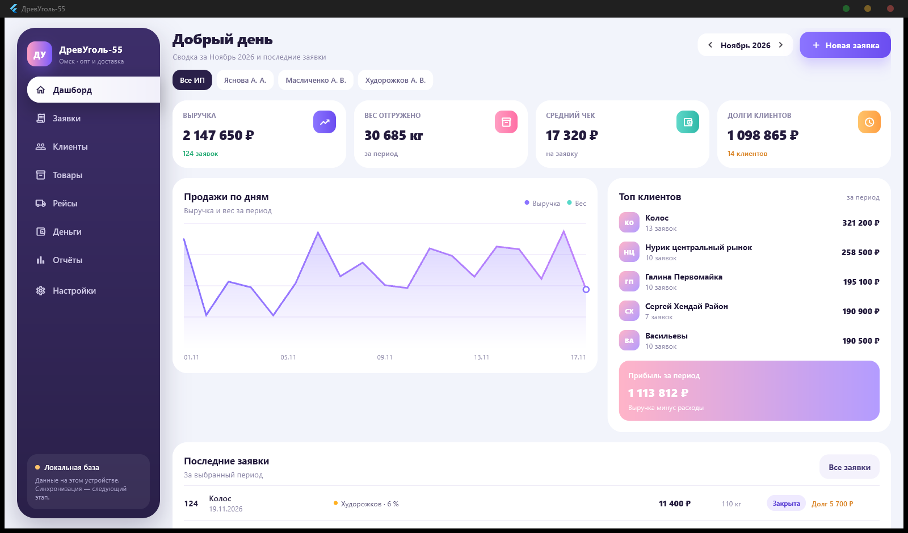
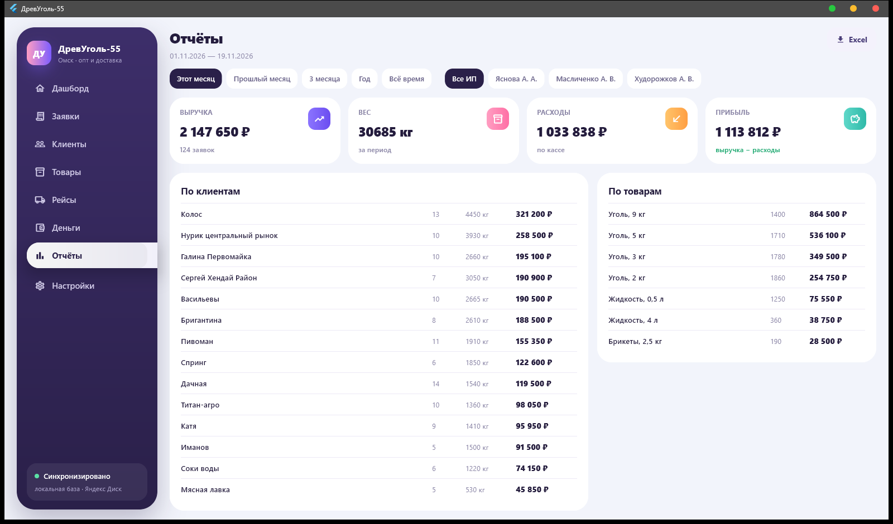
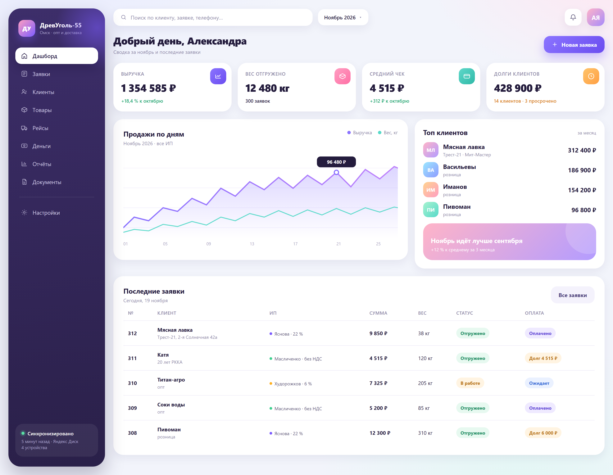
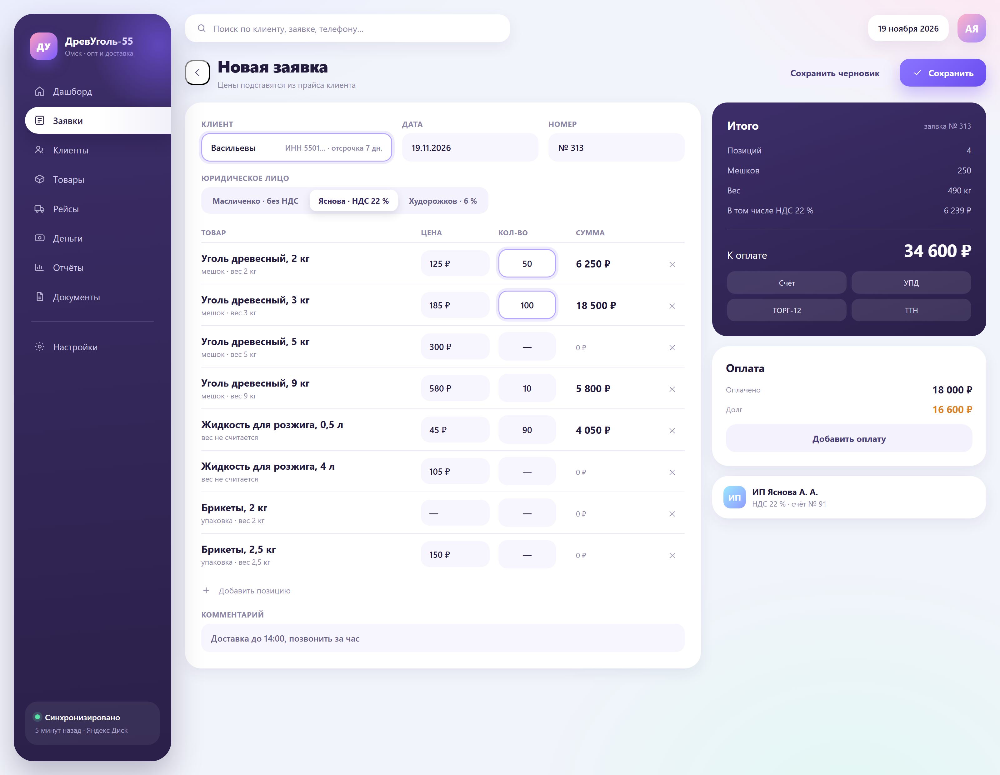
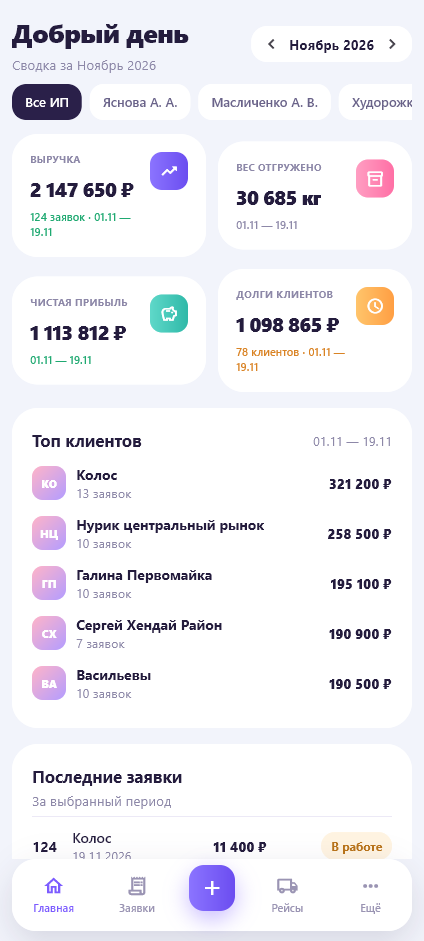
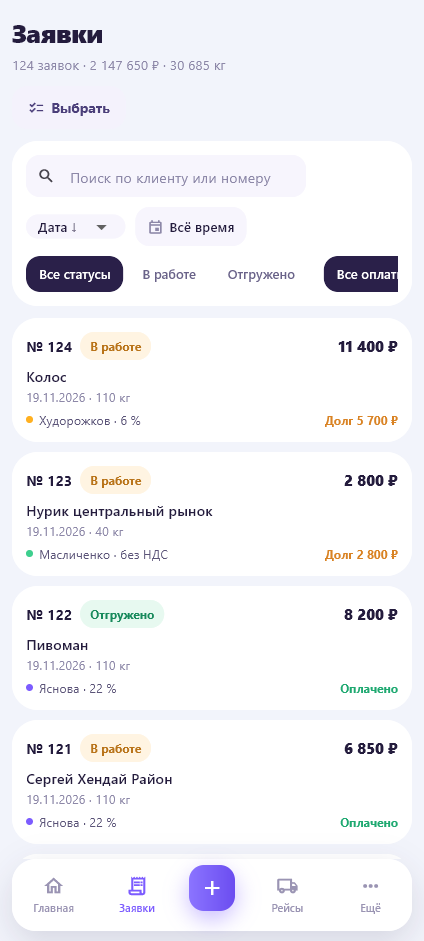
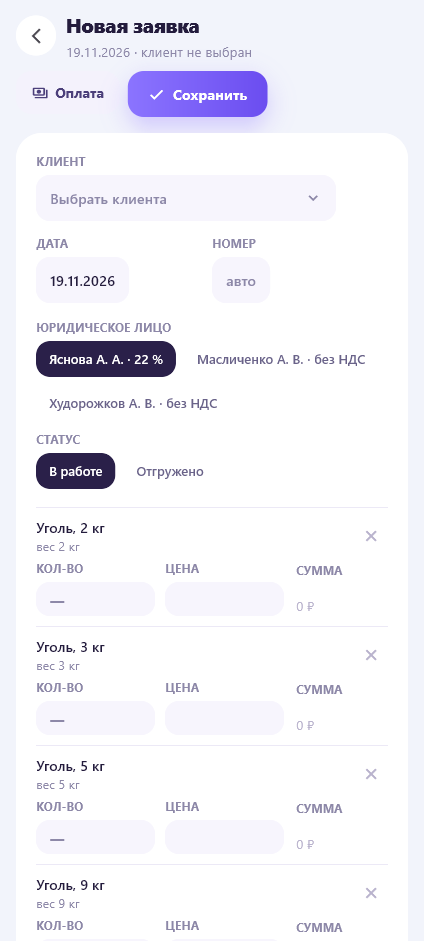
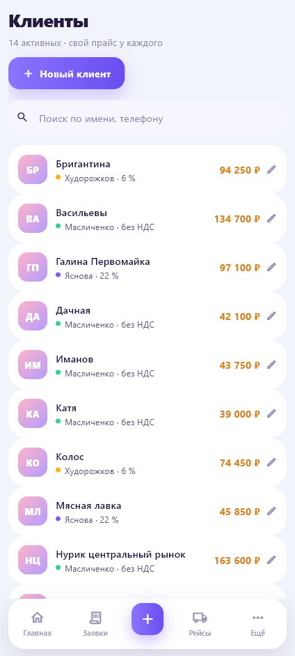

# ДревУголь-55 — приложение

Внутреннее приложение для оптовой продажи и доставки древесного угля (Омск).
Работает офлайн, данные хранятся локально, синхронизация — через Яндекс Диск.

## Скачать и установить

Версия 0.3.0 → **[Releases](https://github.com/GXWag/drevugol-55/releases/tag/v0.3.0)**

**Windows 11**
1. Скачать `drevugol55-windows-0.3.0.zip` и распаковать в любую папку.
2. Запустить `drevugol55.exe`.

**Android**
1. Скачать `drevugol55-0.3.0.apk` на телефон.
2. Разрешить установку из этого источника и установить.

Как проверить версию: в приложении откройте **Настройки** — внизу написано «версия 0.3». Если там 0.1 или 0.2, установился старый файл.

> Первый запуск создаёт демо-данные (клиенты, заявки, расходы), чтобы было видно, как всё работает.

### Если не запускается

**Windows: «Не удается найти VCRUNTIME140_1.dll»** — скачайте архив заново (обновлён 19.11.2026): библиотеки Visual C++ уже лежат рядом с `drevugol55.exe`. Распаковывайте папку целиком.

**Android: висит заставка Flutter** — обновите APK (переустановите поверх). Если снова заставка, теперь приложение покажет экран с текстом ошибки — пришлите его фото.

## Рабочая версия (Windows)

Уже собрано и работает: заявки с индивидуальными ценами, клиенты и прайсы, товары,
рейсы, деньги и расходы, отчёты с выгрузкой в Excel, документы (счёт, УПД, ТОРГ-12, ТТН).

### Дашборд

### Заявки

### Новая заявка

### Клиенты

### Отчёты

### Анимация меню

## Макет (для сравнения)

### Дашборд

### Новая заявка

## Телефон

| Главная | Заявки |
|---|---|
|  |  |

| Новая заявка | Деньги |
|---|---|
|  |  |

| Отчёты | Клиенты |
|---|---|
|  |  |

## Что нового в 0.3.0

- Товары на телефоне — карточками, текст больше не ломается по буквам.
- Главная на телефоне: убран график, выбор месяца перенесён вправо вверх (вместо кнопки создания заявки), плитки выровнены и растянуты по ширине.
- Заявки на телефоне: отступы между карточками, кнопка «Новая заявка» убрана (создание — «плюс» внизу).
- В меню «Ещё» добавлены «Клиенты» — карточки и прайс редактируются.

## Что нового в 0.2.0

- Исправлена мобильная вёрстка (текст больше не идёт по букве в столбик), добавлены отступы по краям.
- В заявке сначала количество, потом цена.
- Два статуса: «В работе» и «Отгружено».
- Заявки: фильтры по оплате, ИП, дате (день или период), сортировка, выбор нескольких заявок с итогами.
- Дашборд: плитки с выбором периода, «Чистая прибыль» вместо среднего чека, график реагирует на ИП и период.
- Отчёты: фильтры по датам и оплате, переход в карточку клиента и в продажи по товару.
- Деньги: редактирование и удаление операций, полный список, поиск и фильтр по датам.
- Убран лишний «плюс» справа снизу; создание заявки — по «плюсу» в нижнем меню.

## Что учтено

- три ИП с разными налогами: Масличенко (наличка, без НДС), Яснова (НДС 22 %), Худорожков (УСН 6 %, без НДС);
- цена привязана к клиенту, а не к товару; подставляется автоматически;
- быстрый ввод: выбрал клиента — вводишь только количества;
- вес считается по углю и брикетам, жидкость не входит;
- статусы, частичная оплата, долги;
- документы: счёт, УПД, ТОРГ‑12, ТТН, накладная.

## Файлы

- `shots/` — скриншоты приложения и макета;
- `desktop-*.html`, `mobile-*.html` — макет, открывается в браузере;
- `style.css` — оформление макета.
