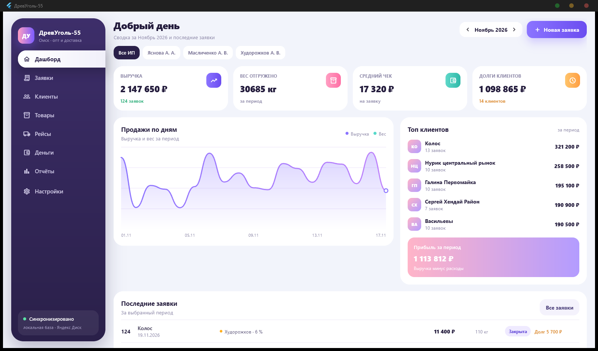
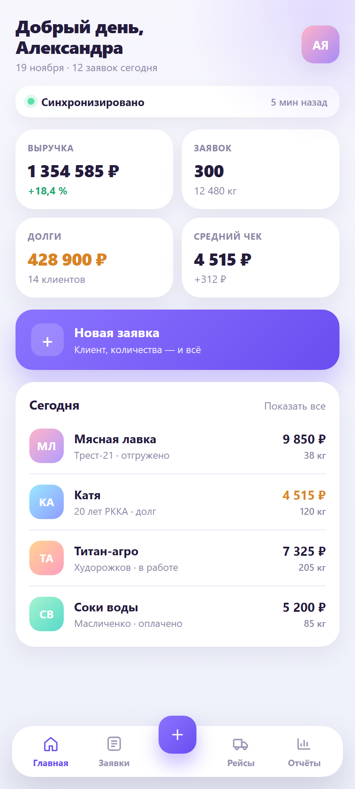

# ДревУголь-55 — приложение

Внутреннее приложение для оптовой продажи и доставки древесного угля (Омск).
Работает офлайн, данные хранятся локально, синхронизация — через Яндекс Диск.

## Рабочая версия (Windows)

Уже собрано и работает: заявки с индивидуальными ценами, клиенты и прайсы, товары,
рейсы, деньги и расходы, отчёты с выгрузкой в Excel, документы (счёт, УПД, ТОРГ-12, ТТН).

### Дашборд

### Заявки

### Новая заявка

### Клиенты

### Отчёты

### Анимация меню

## Макет (для сравнения)

### Дашборд

### Новая заявка

## Телефон

| Главная | Новая заявка |
|---|---|
|  |  |

## Что учтено

- три ИП с разными налогами: Масличенко (наличка, без НДС), Яснова (НДС 22 %), Худорожков (УСН 6 %, без НДС);
- цена привязана к клиенту, а не к товару; подставляется автоматически;
- быстрый ввод: выбрал клиента — вводишь только количества;
- вес считается по углю и брикетам, жидкость не входит;
- статусы, частичная оплата, долги;
- документы: счёт, УПД, ТОРГ‑12, ТТН, накладная.

## Файлы

- `shots/` — скриншоты приложения и макета;
- `desktop-*.html`, `mobile-*.html` — макет, открывается в браузере;
- `style.css` — оформление макета.
